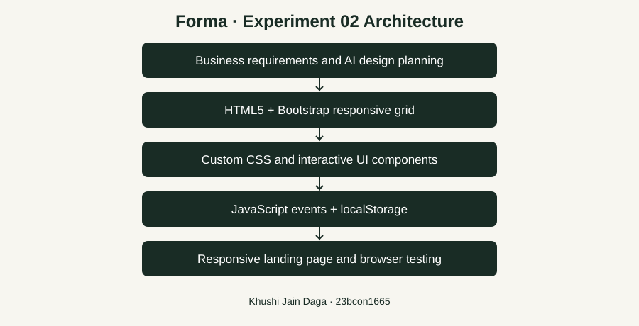

# Forma ✳ — Startup Landing Page

Experiment 02: a responsive landing page prototype for Forma, a fictional team-workspace startup.

**Web Development Using AI · Experiment 02 · Semester VII**

## Student

- **Name:** Khushi Jain Daga
- **Roll number:** 23bcon1665

The website shows the student attribution in the top navigation and footer.

## Project description

Forma presents a calm, premium workspace concept using a sage, cream, and forest-green palette. The page includes a product dashboard demo, feature overview, illustrative customer perspective, pricing plans, and an early-access form.

## Technologies

- HTML5
- CSS3
- Bootstrap 5.3.6 (bundled locally)
- Vanilla JavaScript
- Browser `localStorage` for demo form entries

No package installation, API key, or external service is required.

## Features

- Responsive navigation and layout
- Interactive task dashboard with live completion counts and progress
- Monthly/yearly pricing switch
- Pricing-plan selection from calls to action
- Validated demo form with local-only storage and feedback
- Persistent student attribution in the navigation and footer

This is an academic prototype. Product, testimonials, and prices are illustrative; the form does not send email or collect payments.

## Architecture



See [architecture.svg](architecture.svg) for the project flow:

1. Business requirements and design planning
2. Semantic HTML and Bootstrap responsive layout
3. Custom CSS styling
4. JavaScript interactions and local storage
5. Responsive landing page verification

## Project files

```text
index.html
style.css
script.js
architecture.svg
assets/
  bootstrap.min.css
  bootstrap.bundle.min.js
screenshots/   (currently empty; no screenshots were available)
```

## Run locally

Open `index.html` directly in a modern browser, or start a local server from this directory:

```sh
python -m http.server 8001
```

Then visit <http://localhost:8001>.

## Verification

The page was opened and checked in a browser at viewport widths of 320, 390, 576, 768, and 1440 pixels. The student label remained visible without overlapping the brand or navigation toggle, and no horizontal overflow was detected. The mobile navigation, task counters, and yearly pricing switch were also exercised.

## Academic notes

**Objective:** Build a responsive startup landing page using Bootstrap, HTML, CSS, and JavaScript.

**Limitations:** Forma is fictional. Form entries stay in the current browser's local storage; there is no backend, email delivery, payment processing, or real SaaS service.

**Concepts demonstrated:** Bootstrap grid and breakpoints, semantic HTML, DOM events, form validation, and browser local storage.

## Experiment workflow

Requirements → AI-assisted UI planning → Bootstrap layout → Custom styling → DOM event handling → Responsive testing.

## Implementation details

| Component | Implementation |
| --- | --- |
| Navigation | Bootstrap responsive collapse and sticky header |
| Dashboard | Four task checkboxes, live active/completed counts and progress bar |
| Billing | Monthly/yearly buttons update Team and Studio prices and billing labels |
| Plan selection | Pricing links populate the early-access form |
| Lead capture | Required email field, plan selection, localStorage key `formaLeads` and status feedback |
| Identity | Student attribution in navigation and footer |

## AI-assisted development

AI tool: ChatGPT. The development brief was to create an original responsive Bootstrap startup landing page for Forma, featuring a premium sage-and-cream design, interactive product preview, pricing toggle, illustrative customer perspective and locally stored demo lead form.

## Testing checklist

The existing project verification record reports responsive checks at 320, 390, 576, 768 and 1440 px, and checks of navigation, counters and annual billing. The following additional acceptance checks are recommended before final submission; no new browser execution was performed during this documentation update.

- [ ] Confirm all four checkbox states update the progress bar correctly.
- [ ] Confirm Team and Studio annual rates display ₹399.20 and ₹799.20 (formatting may omit trailing zeroes).
- [ ] Confirm pricing buttons preselect the corresponding plan.
- [ ] Reject empty or invalid email input.
- [ ] Submit a valid demo email and verify local storage and feedback.
- [ ] Capture homepage, features, pricing and form screenshots.

## Result and conclusion

Forma demonstrates a responsive startup landing page using locally bundled Bootstrap, custom CSS and JavaScript DOM interactions. The implementation meets the core academic objective without requiring a backend. Live collaboration, actual subscriptions and remote lead collection are outside the scope of this prototype.
